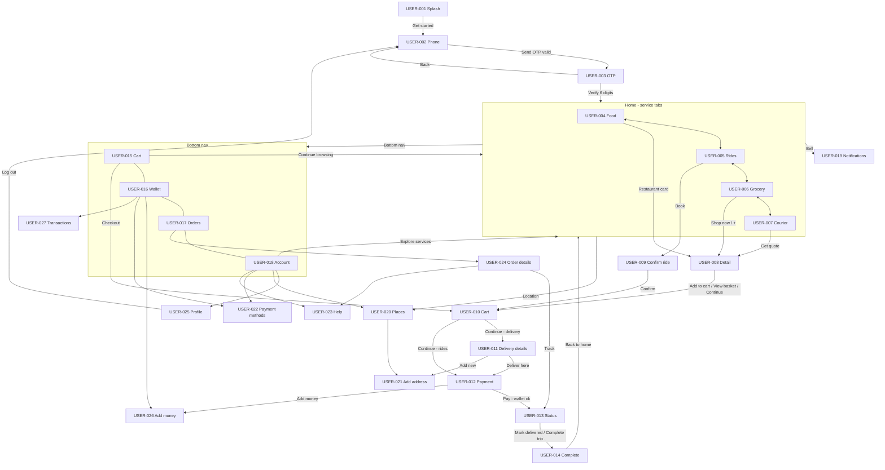

# RoadRider User App — Screen Inventory

Reference: https://stair-linked-07705176.figma.site/ (published Figma Make site)

## How the reference was inspected

- The published site is a compiled React bundle (`assets/index-f0YlRWaC.js`). It was downloaded and
  compared string-by-string with the local `src/App.tsx`. **The published build is the same source
  as the local project, minus one later local addition** (a generic "More" catch-all screen that the
  local code routes every unwired button to).
- A browser walkthrough of the published site captured screenshots of every reachable screen
  (stored in the agent artifacts folder, `01_splash_screen…png` → `17_account_screen…png`).
- Viewports inspected: ~430 px mobile and ~1400 px desktop. On desktop the reference renders the app
  inside a dark phone bezel on a gradient canvas (presentation only).
- Nothing in the reference was inaccessible. The reference simply **does not define** destinations
  for many secondary controls (bell, location, "See all", menu rows, etc.) — in the published build
  those buttons do nothing. These are marked *unresolved in reference* below and their implemented
  destinations follow the content the local source already defined for them (`actionContent`).

## Legend

- **Ref** = present in the published reference. **Local** = present only in local source.
- **Derived** = destination required by a designed control, built from existing design patterns.
- Status: ✅ implemented & verified · 🟡 partial · ❌ missing

## Screen-to-implementation mapping

| ID | Screen | Source | Implementation file | Impl. | Verified |
|---|---|---|---|---|---|
| USER-001 | Splash | Ref | `screens/auth/Splash.tsx` | ✅ | ✅ |
| USER-002 | Phone login | Ref | `screens/auth/PhoneLogin.tsx` | ✅ | ✅ |
| USER-003 | OTP verification | Ref | `screens/auth/OtpVerify.tsx` | ✅ | ✅ |
| USER-004 | Food home | Ref | `screens/home/FoodHome.tsx` | ✅ | ✅ |
| USER-005 | Rides home | Ref | `screens/home/RidesHome.tsx` | ✅ | ✅ |
| USER-006 | Grocery home | Ref | `screens/home/GroceryHome.tsx` | ✅ | ✅ |
| USER-007 | Courier home | Ref | `screens/home/CourierHome.tsx` | ✅ | ✅ |
| USER-008 | Service detail (food restaurant / grocery basket / courier quote) | Ref | `screens/flow/StoreDetail.tsx` | ✅ | ✅ |
| USER-009 | Ride — Confirm booking | Ref | `screens/flow/RideConfirm.tsx` | ✅ | ✅ |
| USER-010 | Checkout cart ("Your cart" / rides variant) | Ref | `screens/flow/Cart.tsx` | ✅ | ✅ |
| USER-011 | Delivery details (address) | Ref | `screens/flow/DeliveryDetails.tsx` | ✅ | ✅ |
| USER-012 | Payment | Ref | `screens/flow/Payment.tsx` | ✅ | ✅ |
| USER-013 | Order status — confirmed / tracking | Ref | `screens/flow/OrderStatus.tsx` | ✅ | ✅ |
| USER-014 | Order complete + rating | Ref | `screens/flow/OrderComplete.tsx` | ✅ | ✅ |
| USER-015 | Cart tab (bottom nav) | Ref | `screens/tabs/NavCart.tsx` | ✅ | ✅ |
| USER-016 | Wallet tab | Ref | `screens/tabs/Wallet.tsx` | ✅ | ✅ |
| USER-017 | Orders tab | Ref | `screens/tabs/Orders.tsx` | ✅ | ✅ |
| USER-018 | Account tab | Ref | `screens/tabs/Account.tsx` | ✅ | ✅ |
| USER-019 | Notifications | Local | `screens/more/Notifications.tsx` | ✅ | ✅ |
| USER-020 | Choose a location / Saved addresses | Local | `screens/more/Places.tsx` | ✅ | ✅ |
| USER-021 | Add new address | Derived | `screens/more/AddAddress.tsx` | ✅ | ✅ |
| USER-022 | Payment methods | Local | `screens/more/PaymentMethods.tsx` | ✅ | ✅ |
| USER-023 | Help & support | Local | `screens/more/Help.tsx` | ✅ | ✅ |
| USER-024 | Order details | Local | `screens/more/OrderDetail.tsx` | ✅ | ✅ |
| USER-025 | Profile & settings | Local | `screens/more/Profile.tsx` | ✅ | ✅ |
| USER-026 | Add money | Local | `screens/more/AddMoney.tsx` | ✅ | ✅ |
| USER-027 | Transactions / statements | Derived | `screens/more/Transactions.tsx` | ✅ | ✅ |

Totals: **18** screens in the published reference, **7** destinations defined only in local source
(USER-019, 020, 022–026, all from `actionContent`), **2** derived (USER-021, USER-027). Removed: the
local generic "More options" catch-all (prototype-only; replaced by USER-019…027).

Not separate screens (states/variants): food/grocery/courier detail variants of USER-008; confirmed vs
tracking stage of USER-013; rides vs delivery variant of USER-010; Active/Past tabs of USER-017.

---

## Screen details

### USER-001 Splash
- Purpose: brand intro. Entry: app launch when signed out.
- Sections: full-bleed rider photo + gradient, logo + tagline, eyebrow, H1 "Everything you need in one
  app.", copy, 4 service chips (Food, Rides, Grocery, Courier), "Get started", photo credit.
- Actions: Get started → USER-002.

### USER-002 Phone login
- Sections: logo, tagline, CSS illustration, "Let's get started", +91 phone input, Send OTP,
  "or continue with" G / Apple / Email, legal text.
- Validation: 10-digit Indian mobile starting 6–9 (spaces ignored). Error message + disabled state.
- Actions: Send OTP → USER-003. Google/Apple/Email → no provider configured: inline message, no
  navigation (reference navigated straight to OTP, which would imply a sign-in that never happened).
- Back: browser/system back → USER-001.

### USER-003 OTP verification
- Sections: back button, logo, "Verify your number", entered number, 6 OTP boxes, Resend, Verify &
  continue, numeric keypad.
- Validation: exactly 6 digits; Verify disabled until complete. Keypad + hardware keyboard input.
- Resend: 30 s cooldown. **Demo mode notice**: no SMS provider exists, so the screen states that no
  SMS was sent and any 6 digits are accepted.
- Actions: Back → USER-002. Verify → app home (USER-004 by default).

### USER-004 Food home
- Sections: hero photo, header (location, bell, avatar), service tabs, kicker + H1, search bar with
  filter, "What are you craving?" categories (emoji per design), "Popular near you" restaurant card
  (20% OFF, heart, 30 min, rating), "Offers for you" (2 cards), bottom nav.
- Actions: location → USER-020 (select); bell → USER-019; avatar → USER-018; service tabs → 004–007;
  search filters restaurants/dishes (empty state); filter → sort sheet; category → filter; More →
  extra cuisines sheet; See all → show all; heart → favourite toggle; card → USER-008 (food);
  offer card → shows promo code toast.

### USER-005 Rides home
- Sections: header, service tabs, segment (Book a ride / Hourly rental), illustrated map, pickup /
  destination rows, "Choose a ride" (Bike, Auto, Cab, Cab XL with fare range + ETA), Book button.
- Actions: ride option select (button label updates); pickup / destination → USER-020; Hourly
  rental → "not available yet" state; Book → validation (destination required) → USER-009.

### USER-006 Grocery home
- Sections: header, tabs, hero, search, "Shop by category", green banner "Up to 30% off", "Daily
  essentials" product grid (discount, heart, price, MRP, +).
- Actions: search/category filter with empty state; See all; heart; + adds to cart → USER-008
  (basket); Shop now → USER-008.

### USER-007 Courier home
- Sections: hero, header, tabs, sheet with segment (Send / Track package), pickup & delivery rows,
  package type grid (DOC/S/M/L), estimate, Get quote, trust row.
- Actions: package select updates estimate; locations → USER-020; Get quote (delivery location
  required) → USER-008 (courier quote). Track package → order-ID lookup → USER-013 or error.

### USER-008 Service detail
- Food: cover, badge, restaurant name, cuisine, stats, "Recommended for you" line items with Add +
  / stepper, sticky "Add to cart · ₹total" (disabled when empty).
- Grocery: "Your basket" — basket items with steppers, empty state, "View basket · ₹total".
- Courier: "Your delivery quote" — quote line item with Select, "Continue to payment".
- Next → USER-010.

### USER-009 Ride — Confirm booking
- Map, ride summary + fare, pickup/destination rows, driver-arrival estimate (labelled estimate),
  payment row, "Confirm <ride> · ₹fare" → USER-010.

### USER-010 Checkout cart
- Line items with quantity stepper (removal at 0, empty state), promo code row → bottom sheet
  (WELCOME50), bill details computed from cart. Rides/courier: single booking line, no stepper.
- Continue → USER-011 (delivery services) or USER-012 (rides).

### USER-011 Delivery details
- Mini map, "Choose an address", saved addresses (radio), "+ Add new" → USER-021.
- Deliver here (requires a selection) → USER-012.

### USER-012 Payment
- Total card, payment methods: RoadRider Wallet (balance), UPI, Card.
- Wallet: insufficient-balance error + Add money link. UPI/Card: no gateway → error, cannot pay.
- Pay → creates order (demo), debits demo wallet, clears cart → USER-013.

### USER-013 Order status (confirmed / tracking)
- Map, logo, Help, sheet with eyebrow, title, partner card (call → unavailable notice), status
  steps. Status progresses via a **clearly labelled simulation** (no live GPS / courier data).
- Buttons: View tracking (confirmed stage); Mark as delivered / Complete trip → USER-014.
- Help → USER-023.

### USER-014 Order complete
- Success mark, summary, receipt (total, payment), 1–5 star rating (saved), Back to home → USER-004…7.

### USER-015 Cart tab
- Utility header, service chip, cart card, quantity stepper (food/grocery) or route rows
  (rides/courier), bill, Continue browsing, primary CTA. Empty state when nothing is in progress.

### USER-016 Wallet tab
- Balance hero + Add money (USER-026), quick actions (Payment methods → USER-022, Auto top-up →
  toggle, Statements → USER-027), recent transactions (See all → USER-027), linked card → USER-022.

### USER-017 Orders tab
- Active / Past tabs with count; order cards → USER-024.

### USER-018 Account tab
- Profile card (Edit → USER-025), wallet card (Add money → USER-026), Your activity (Active/Past,
  See all → USER-017, card → USER-024), menu (Saved addresses → USER-020 manage, Payment methods →
  USER-022, Your orders → USER-017, Help & support → USER-023, Profile & settings → USER-025),
  Explore services → USER-004…007.

### USER-019 … USER-027 (local / derived destinations)
All use the local `more-page` visual pattern (back button, icon tile, eyebrow, H1, description,
list card, sticky Done/primary button).
- 019 Notifications: list, unread state, mark all read.
- 020 Places: select mode (delivery/pickup/drop) or manage mode (set default, delete, add).
- 021 Add address: label chips, address line + area fields with validation.
- 022 Payment methods: wallet, linked Visa, add UPI/card → unavailable (no gateway).
- 023 Help: topics; chat/call → unavailable notice (no support integration).
- 024 Order details: items, bill, status, Track (active) / Help.
- 025 Profile: name (required) edit, phone read-only, language, Log out.
- 026 Add money: ₹200/₹500/₹1,000 + custom (₹10–₹10,000); demo credit, clearly labelled.
- 027 Transactions: full wallet history.

---

## Navigation map

### Unresolved in the reference
- The bottom nav has **no Home item** (Cart, Wallet, Orders, Account only). Kept as designed; Home is
  reached via Cart → "Continue browsing", Account → "Explore services", or back from a root tab.
- Hourly rental content, restaurant "See all" list, and filter options are not designed.
- The rides cart step is titled "Finding your driver" in the reference although payment has not
  happened yet; implemented as "Ride summary" (see discrepancies).

## Known discrepancies vs reference
| Area | Reference | Implementation | Reason |
|---|---|---|---|
| Bill maths | Food: items ₹289 + taxes ₹18 = "To pay ₹289" | ₹289 + ₹18 = ₹307 | Totals must add up |
| Rides/courier taxes | Taxes ₹18 but total = fare | "Included" | Fare already inclusive |
| Grocery basket | Fixed "Fresh produce basket ₹328" | Real basket items | Cart state is the source of truth |
| OTP / phone | Pre-filled number and "482" | Empty fields, validation, demo notice | No real OTP provider |
| Social login | Jumped to OTP | Shows "not configured" | No auth provider |
| Tracking copy | "LIVE UPDATE", "Arriving in 18 minutes" | "SIMULATED UPDATE", status-based copy | No live tracking integration |
| Rides cart title | "Finding your driver" | "Ride summary" | Driver search starts only after payment |
| Ride/courier stepper | Quantity stepper shown | Hidden | A booking has no quantity |
| Desktop framing | Phone bezel on gradient canvas | Plain centred app column | Presentation-only, removed |
